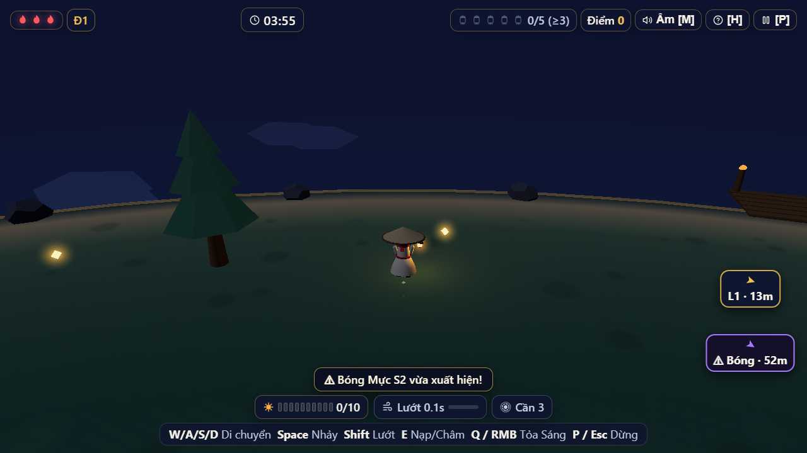

# Đảo Đèn Lồng — Bình Minh (`v1.0.0` · Contract `v1.3`)

- **Video demo (`.mp4`, `1280×720`):** [docs/demo/demo.mp4](docs/demo/demo.mp4) · **Bản phát hành GitHub:** [Release v1.0.0](https://github.com/LysLama/K5-L3A-DAY12-LyThanhLam-2A202603475-AI-SDLC-Dao-Den-Long/releases/tag/v1.0.0)



Game sinh tồn 3D trên nền WebGL (**Three.js 0.187.0**) kết hợp **lõi mô phỏng tất định `60 Hz`** tách rời hoàn toàn khỏi trình duyệt. Bạn nhập vai **Mây** bảo vệ 3 hòn đảo (**Đảo Bến → Đảo Cau → Đảo Chuông**) bằng cách thu thập đom đóm, thắp & châm dầu đèn lồng trước sự quấy phá của **Bóng Mực** và **Gió Lạc** cho tới bình minh.

---

## Cài đặt & Chạy nhanh (3 lệnh)

> Yêu cầu: **Node.js ≥ 20** (khuyến nghị Node `22`) và `npm`.

```bash
git clone https://github.com/LysLama/K5-L3A-DAY12-LyThanhLam-2A202603475-AI-SDLC-Dao-Den-Long.git && cd K5-L3A-DAY12-LyThanhLam-2A202603475-AI-SDLC-Dao-Den-Long
npm ci && npm run build
node dist-app/run.mjs
```

Mặc định server phục vụ tại `http://127.0.0.1:4173` kèm API lưu **Bảng xếp hạng Top 10** vào `~/.dao-den-long/leaderboard.json` (tùy biến qua `--port <n>`, `--host <addr>`, `--leaderboard-file <path>` hoặc biến môi trường `DDL_LEADERBOARD_PATH`).

---

## Điều khiển & Trợ năng

Mọi phím dưới đây đều có thể **đổi tùy ý** trong **Cài đặt & Trợ năng** (tự phát hiện xung đột phím & có nút khôi phục mặc định):

| Hành động | Phím mặc định | Ghi chú |
|---|---|---|
| Di chuyển | `W` `A` `S` `D` (hoặc phím mũi tên) | `6.0 m/s`, giữ điều khiển đầy đủ trên không |
| Nhảy | `Space` | Chỉ nhảy khi chạm đất |
| Lướt nhanh (Dash) | `Shift` | `14 m/s` trong `0.2 s`, hồi chiêu `1.5 s`, giữ độ cao khi lướt trên không |
| Tương tác / Thắp & Châm dầu | `E` | Bán kính `2.0 m`; thắp mới `10` đom đóm, thắp lại `5`, châm dầu đèn đang sáng |
| Tỏa Sáng (Pulse) | `Q` / Chuột phải | Tốn `3` đom đóm, bán kính `5 m`, choáng Bóng Mực `2.0 s` & đẩy `4 m` |
| Xoay camera | Chuột / Kéo chuột | Tinh chỉnh độ nhạy trong Cài đặt |
| Tạm dừng / Tiếp tục | `P` / `Esc` | Mở Bảng tạm dừng & Cài đặt |
| Bật/Tắt âm thanh | `M` | Âm thanh tổng hợp Web Audio (Procedural, không tài sản bản quyền ngoài) |
| Bảng hướng dẫn nhanh | `H` | Hiện nhắc phím và mẹo sinh tồn |

**Trợ năng (`>= 18px` base UI):** Hỗ trợ **Chữ lớn (`×1.25`)**, **Giảm chuyển động** (tắt rung camera & hiệu ứng chớp) và **Bảng màu dễ phân biệt** đồng bộ cả giao diện lẫn vật thể 3D; toàn bộ lựa chọn lưu bền vững qua `localStorage`.

---

## Kiểm thử, Headless Contract `v1.3`, Benchmark, Soak & Đóng gói

### 1. Bộ kiểm thử & Nghiệm thu 1 lệnh (`npm run verify`)
```bash
npm test            # Chạy unit & contract test (Vitest)
npm run verify      # Chạy cổng kiểm chứng toàn phần 7/7 bước (tests + 14 kịch bản + determinism + CLI 21,600 ticks + leaderboard + soak + bench)
```

### 2. Chế độ Headless (`headless_cmd`)
```bash
node dist-headless/cli.mjs --night 1 --seed 42 --input path/to/actions.json --out out.jsonl
```

### 3. Chế độ Benchmark đồ họa `1280×720` (`bench_cmd`)
```bash
node dist-app/bench.mjs --seed 42 --duration 30 --out bench.json
```
- Mở cửa sổ Electron `1280×720` không toàn màn hình (`useContentSize: true`, `fullscreen: false`), tải **Đêm 1** đầy đủ ánh sáng/hiệu ứng với đúng **`200` Bóng Mực** (`wander`), **`100` đom đóm**, **`L1–L3` sáng `fuel=100`**, Mây đứng tại `(0,0,0)` và camera bay vòng tròn bán kính `30 m`, `Y = 15 m`, `15 s`/vòng (`3 s` khởi động đầu không đo).
- **Ghi chú VSync:** Chromium/Electron được khởi chạy kèm `--disable-gpu-vsync` và `--disable-frame-rate-limit` (trên Windows dùng thêm `--use-angle=gl --enable-high-performance-gpu --ignore-gpu-blocklist` để tránh nghẽn đồng bộ D3D11 DXGI), báo cáo `"vsync_off": true`. Kết quả đã đo ghi trong [bench.json](bench.json).

### 4. Chạy thử dài hạn 10 đêm (`soak_cmd`) & Bảng xếp hạng
```bash
node dist-app/soak.mjs --seed 7 --nights 10 --out soak.json
node dist-app/run.mjs --export-leaderboard leaderboard-export.json
```
- `soak.mjs` chạy `10` đêm liên tiếp luân phiên `1 → 2 → 3` và xuất [soak.json](soak.json).

### 5. Docker & Gói phát hành tĩnh
```bash
docker build -t dao-den-long:1.0.0 .
docker run --rm -p 4173:4173 dao-den-long:1.0.0
```
- Tạo file nén phát hành di động `release-dist/dao-den-long-v1.0.0-web.zip`:
```bash
npm run package:release
```

---

## Sáng tạo của tôi & Đảm bảo parity Headless

- **Ba hòn đảo với địa hình & không khí riêng:** *Đảo Bến* (Đêm 1), *Đảo Cau* (Đêm 2 với Bùa Tỏa Sáng tăng sức chứa `10 → 20`), và *Đảo Chuông* (Đêm 3 có Gió Lạc thổi lệch hướng & nhiều Bóng Mực).
- **Nhân vật Ông Đăng & Lồng dẫn truyện:** Mỗi đêm mở đầu với lời dặn ngắn của Ông Đăng cùng hệ thống nhắc mục tiêu, mũi tên chỉ hướng chống chồng lấn, tia hút dầu `drain` 3D và thanh nhiên liệu nhấp nháy `1 Hz` khi `fuel < 30`.
- **Tối ưu WebGL (`InstancedMesh`):** Toàn bộ đèn lồng, cây, đá, mây, đom đóm và `200` Bóng Mực được instancing để duy trì FPS cao ngay trên iGPU laptop.
- **Tương đương Headless & Benchmark chuẩn:** Lõi mô phỏng ở `src/sim/` chạy thuần TypeScript không phụ thuộc DOM/Three.js; mọi hiệu ứng trang trí phía client và phần sáng tạo thêm không can thiệp vào đầu ra JSONL headless hay cảnh chuẩn `createBenchWorld` (`--bench` tắt sinh thực thể, sát thương, nhặt đom đóm, hao dầu và kết thúc Đêm).

---

## Tài liệu & Bằng chứng Phát triển (AI-SDLC)

- [game.contract.json](game.contract.json) — Khai báo Contract `v1.3`
- [CHANGELOG.md](CHANGELOG.md) — Lịch sử phát hành `v1.0.0` (Phase 1 → 4)
- [CREDITS.md](CREDITS.md) & [LICENSE](LICENSE) — Nguồn công nghệ, tài sản & giấy phép MIT
- [docs/notes/retro.md](docs/notes/retro.md) — Đánh giá & Hồi cứu 4 Phase
- [docs/notes/ai-log.md](docs/notes/ai-log.md) — Nhật ký dùng AI, lỗi & ước tính token/chi phí
- [docs/notes/phase-4-assumptions.md](docs/notes/phase-4-assumptions.md) & `ADR-002` — Giả định & quyết định kiến trúc Phase 4
- [docs/proof/phase-4-proof.md](docs/proof/phase-4-proof.md) (cùng `phase-1-proof.md` → `phase-3-proof.md`) — Bằng chứng kiểm chứng từng phase
